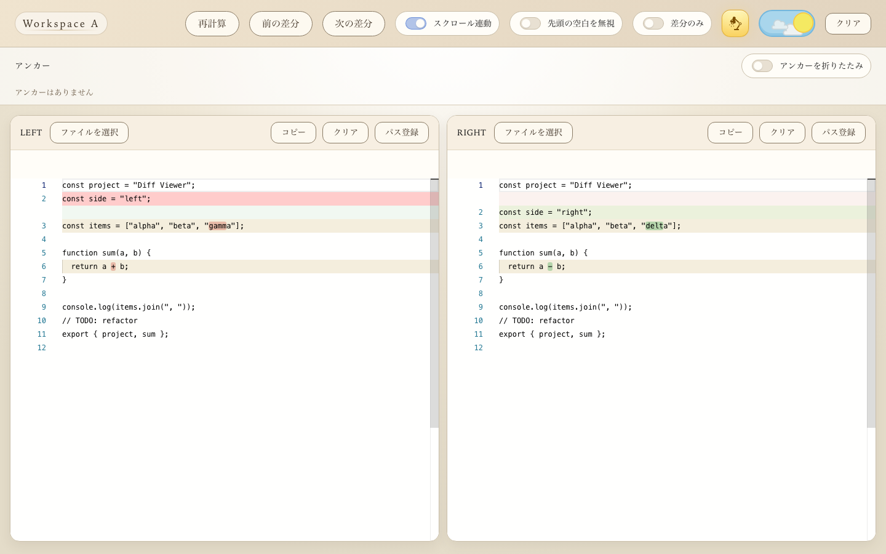

# Diff Viewer

**HTML 1ファイルで使える、オフライン対応のコード・テキスト比較ツール。**

VS Code に近い左右2ペインの画面で、行単位・行内の変更を確認しながら編集できます。編集すると差分は自動で更新されます。左右の独立スクロールを出発点に、手動アンカーでの行の対応付け、複数ファイルの比較、作業の再開や結果の共有まで扱えるようになりました。

## すぐに使う

1. [最適化版の HTML](dist/index.min.html) または [可読版の HTML](dist/index.html) を手元に保存し、ブラウザで開きます。サーバーやインストールは不要です。
2. 左右のペインにテキストを貼り付けるか、ファイルを選択・ドロップします。
3. 「前の差分」「次の差分」で変更箇所を確認します。左右で別々の位置を見たいときは「スクロール連動」を OFF にします。

詳しい操作は、画面右上の本アイコンか [操作マニュアル](doc/manual.md) から確認できます。



## 比較を進める

- **表示を切り替える** — 「スクロール連動」は既定で ON。OFF にすると左右を独立してスクロールでき、差分ジャンプで両側を同じ変更箇所に揃えられます。「差分のみ」で変更のない範囲を折りたたみ、「先頭の空白を無視」で行頭の半角スペースとタブを比較から外せます。
- **対応行を指定する** — 左右の行番号を順にクリックして、対になる行を手動アンカーで固定します。差分はアンカーを基準に再計算されます。編集や再読み込み後も、対応を一意に特定できる行は追跡し、曖昧なものは「要確認」に移します。
- **複数ファイルをまとめて比較する** — 各ペインに複数のファイルを連結して表示します。ファイルカードから各ファイルの先頭へ移動でき、行番号はファイルごとに表示されます。UTF-8・Shift_JIS・EUC-JP が混在していても、文字コードはファイル単位で判定します。

## 作業を再開・共有する

| やりたいこと | 使う機能 |
| --- | --- |
| 別の比較に切り替えたり、後で続きを開いたりする | **ワークスペース**に左右の本文とアンカーなどを保存。JSON に書き出して別の環境でも読み込めます。 |
| 左右の行の対応付けだけを渡す | **アンカー JSON** に有効な手動アンカーを書き出します。共有先では対応する比較対象を開いてから読み込みます。 |
| 比較結果を閲覧用に渡す | **レポート出力**で、左右の行を揃えた2列の HTML を保存します。シンプルとリッチの2種類があります。 |
| 表示どおりの行並びを貼り付ける | 各ペインの **ソースコピー**で、位置合わせ用の空行を含むテキストをコピーします。 |

外部ツールから比較データを読み込む場合は [ワークスペース JSON の仕様と最小例](doc/SPEC.md#1121-ワークスペースjson-v1) を参照してください。

## 起動オプション

既定は「保存なし」画面です。元ファイルへの上書き保存を有効にするなど、開き方を変えるには HTML の URL にオプションを追加します。

| オプション | 動作 |
| --- | --- |
| `?save=on` | 元ファイルへの上書き保存を有効にします。 |
| `?diff=off` | 通常の差分計算を停止し、手動アンカーで指定した行だけを比較します。 |
| `?highlight=off` | 差分計算は続け、手動アンカーで指定した行だけを差分ハイライトの対象にします。 |
| `?manual=on` | 内蔵の操作マニュアルを開きます。 |

オプションは `index.html?save=on&diff=off` のように併用できます。上書き保存と再読み込みには、ブラウザが提供するファイルハンドルと対応する権限が必要です。複数ファイルへ書き戻す場合は、すべてのファイルに書き込み権限があり、編集が各ファイルの範囲内に収まっている必要があります。[保存と再読み込みの手順](doc/manual.md#4-保存と再読み込み)

## 開発とビルド

Node.js と pnpm を用意し、リポジトリのルートで実行します。

```sh
pnpm install --frozen-lockfile
pnpm run dev
```

| コマンド | 内容 |
| --- | --- |
| `pnpm run check` | 型チェックと全テストを実行 |
| `pnpm run build:single` | 可読版と最適化版の単一 HTML を生成し、配布物を検証 |
| `pnpm run verify:dist` | 既存の `dist/index.html` と `dist/index.min.html` を検証 |

配布前には両方の HTML をブラウザで直接開き、主要機能を確認します。Rust は埋め込み WASM の再生成や Rust 側のテストに必要です。[開発環境のセットアップ](doc/SETUP.md)

## ドキュメント

- [仕様書](doc/SPEC.md) — 挙動、データ形式、配布要件の正本。仕様変更時は README も追従させます。
- [プロジェクト構成](doc/STRUCTURE.md) — Monaco Editor を使う UI と、そこから独立した差分エンジンの構成。
- [パフォーマンス計測](doc/PERFORMANCE_BOTTLENECKS.md) — 実行時の計測と、TypeScript・WASM 実装の比較手順。
- [コードリーディング教材](text/README.md) — TypeScript 初学者向けの実装ガイド。
